# Trunks behind NAT: when inbound calls stop but the trunk says "Registered"

A registering trunk behind a router fails in a way that hides itself. Outbound calls work, the
portal shows the trunk up, Asterisk reports **Registered**, the keep-alive probe is answered in a
few milliseconds — and not one call comes in. Hours later somebody places a call and inbound
starts working again, so it looks like the PBX "went to sleep".

It is not the PBX. It is the port the router gives you.

## What actually happens

The PBX sends its registration from a port on your network. The router rewrites that to a port of
its own on the public address, and the carrier remembers **the address and port it saw**. Every
inbound call is then sent there.



When the router hands out a different outside port — the mapping was dropped, rotated, or the WAN
reconnected — the carrier carries on sending to the old one. Nothing tells the PBX:

| What you check | What it says | Why it is useless here |
|---|---|---|
| `pjsip show registrations` | Registered | Asterisk trusts its own registration until it expires |
| `pjsip show aor <trunk>` | Avail, 18 ms | The probe makes its own path out and back |
| Outbound calls | Work | They also make their own path out |
| Firewall, fail2ban | Nothing blocked | The packets never reach the PBX |

Only the carrier knows, and it has no way to tell you. The gap lasts until the next registration,
which is why a long registration period turns a momentary network event into an hour of silence.

The tell-tale sign is in an inbound INVITE: the port is not 5060.

```
asterisk -rx "pjsip set logger on"
# place a call to one of your numbers
grep -m1 "^INVITE sip:" /var/log/asterisk/messages.log
INVITE sip:15555550123@203.0.113.10:30306 SIP/2.0     <-- a port the router picked
```

## The fix, in three parts

### 1. Keep the outside port still (the real fix)

Tell the router to stop rewriting the PBX's SIP source port. On **pfSense**:

1. **Firewall → NAT → Outbound**, set Mode to **Hybrid Outbound NAT**, Save.
2. Add a mapping above the automatic rules: Interface **WAN**, Protocol **UDP**, Source **the PBX's
   address /32**, Destination **any** (or just the carrier's network), and tick **Static Port**.
3. Save, then **Apply Changes**.
4. **Firewall → Advanced → Firewall Optimization Options: Conservative**, so UDP states live longer.
5. Turn off any SIP ALG or `siproxd`: rewriting SIP packets causes this same failure in other ways.

Other routers call it *SIP port preservation*, *symmetric NAT off* or *consistent NAT*. A port
forward of UDP 5060 to the PBX does the same job and is worth adding if you are happy to accept
unsolicited SIP on that port; the static-port mapping alone does not expose anything, because
replies arrive on a state the PBX itself opened.

After changing this, make the carrier learn the new port at once — otherwise it keeps using the old
one until the registration expires:

```
asterisk -rx "pjsip send unregister <trunk>-reg"
sleep 3
asterisk -rx "pjsip send register <trunk>-reg"
sleep 5
asterisk -rx "pjsip show registrations"
```

### 2. Re-register often (the safety net)

Since OwnPBX 1.75.33 a registering trunk refreshes every **180 seconds** instead of every hour, and
the keep-alive probe runs every **30 seconds** (Trunks → *Authentication* and *Network & NAT*). If
the outside port ever does change, the carrier is corrected within minutes rather than within the
hour. Existing trunks were moved down from an hour by a migration. There is no reason to raise it
again: a registration is two small packets.

### 3. Or sidestep NAT entirely

A TCP or TLS trunk holds one connection open to the carrier, and inbound calls come back down that
same connection, so a changing outside port stops mattering. Set the carrier's account to accept
encrypted SIP, then set the trunk's transport to **TLS** and its port to **5061**. The port number
is not what makes this safer — TLS is; 5061 is only the convention.

## What does not fix it

- **Whitelisting the carrier** in the firewall or fail2ban. Check first whether anything is blocked
  (`fail2ban-client banned`); if the PBX already accepts SIP on 5060, the packets are being lost
  before they arrive, and a whitelist changes nothing.
- **An edge proxy (Kamailio, an SBC)** *inside* the same network. It is behind the same NAT. One on
  a public VPS does fix it, by moving the carrier-facing side out of NAT altogether, but that is a
  second server to run and secure for something a router setting solves.
- **A Cloudflare tunnel.** It carries the portal, the browser phone and the mobile apps, because
  those are HTTP and WebSocket. A SIP trunk is neither, so it leaves through the router as usual
  and is subject to everything on this page. Seeing the apps work through the tunnel while inbound
  trunk calls fail is expected, not a clue.

## Related

- 🌐 [Trunks](trunks.md) — the trunk form, identification, registration settings
- 🎧 [WebRTC, NAT and TURN](webrtc-nat.md) — the same subject for the browser phone and the apps
- 🩺 [Health checks](health.md) — the alarm that fires when a trunk stops being registered; set a
  recipient, or it only ever appears in the portal
- 🛠️ [Troubleshooting](troubleshooting.md) — symptom to fix, across the whole system
